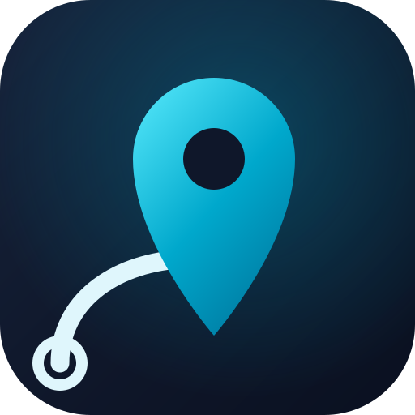

# 🚚 Delivery Route Planner

  

A web-based route optimization application designed specifically for delivery drivers to maximize efficiency, calculate distances, estimate travel times, and project potential earnings.

---

## ✨ Key Features

| Feature | Description |
|---------|-------------|
| **Interactive Map** | Built with Leaflet.js for a responsive and intuitive mapping experience |
| **Smart Location Search** | Autocomplete functionality using Photon API for precise address finding |
| **Flexible Route Planning** | Add unlimited waypoints between start and end locations |
| **Optimized Route Calculation** | Leverages OSRM routing engine for optimal path determination |
| **Comprehensive Delivery Metrics** | Displays distance, estimated travel time, and earnings (RM 0.60/km) |
| **Visual Route Mapping** | Clear visualization of calculated routes on the interactive map |
| **Summary Export** | Generate and download visual route summaries as images |

---

## 🛠️ Technology Stack

| Component | Technology |
|-----------|------------|
| **Mapping Framework** | Leaflet.js |
| **Map Data Source** | OpenStreetMap |
| **Geocoding Service** | Photon API |
| **Routing Engine** | OSRM API |
| **Image Generation** | html2canvas |
| **Core Technologies** | HTML5, CSS3, JavaScript |

---

## 📋 User Guide

### Step-by-Step Instructions

1. **🏁 Set Start Location**  
   Enter your starting point in the "Start location" field

2. **➕ Add Waypoints**  
   Click "+ Add Location" to include intermediate stops as needed

3. **🎯 Set Destination**  
   Enter your final destination in the "Destination" field

4. **🧮 Calculate Route**  
   Click "Calculate Route" to generate the optimal path

5. **📊 View Results**  
   Review distance, estimated time, and earnings in the metrics panel

6. **💾 Download Summary**  
   Click "Download Summary" to save a visual route summary

---

## 🚀 Quick Start

This application runs entirely in your browser - no installation required:

1. Download the `index.html` file
2. Open it in any modern browser (Chrome, Firefox, Safari, Edge)
3. Start planning your optimized delivery route immediately!

---

## ⚠️ Limitations

> **Important Notes:**  
> - Earnings calculation uses a fixed rate of **RM 0.60 per kilometer**  
> - Route optimization is designed **exclusively for driving** routes  
> - Location search is **limited to Malaysia** (bounding box: 109.5,0.8,115,5.5)
